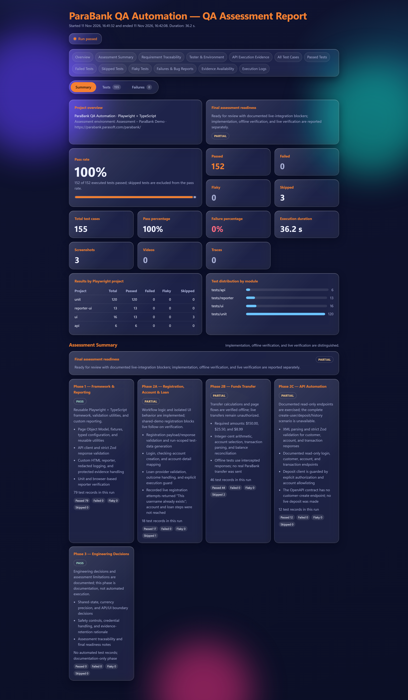

# ParaBank QA Automation

**UI and API Automation Framework using Playwright and TypeScript**

This project is part of a Senior QA Automation Engineer assessment. The objective was to build a maintainable automation framework for testing the ParaBank application and its APIs.

The framework uses Playwright with TypeScript and follows the Page Object Model. It includes reusable page classes, API testing, test data generation, response validation, and a custom HTML report.

## Assessment Report

The HTML report provides an overview of test execution, phase-wise progress, test results, and available evidence.

**[View the Interactive QA Assessment Report](https://kunalshivankar.github.io/parabank-qa-automation/reports/parabank-report.html)**

[](https://kunalshivankar.github.io/parabank-qa-automation/reports/parabank-report.html)

## Project Overview

The framework was developed with a focus on code reusability, maintainability, and clear test reporting.

The main areas covered are:

- UI automation using Playwright and TypeScript.
- Page Object Model for managing page locators and actions.
- API automation using Playwright APIRequestContext.
- Response validation using Zod schemas.
- Dynamic test data generation.
- Currency calculations using integer values to avoid floating-point errors.
- Custom HTML reporting.
- Logging and sensitive-data handling.
- Environment-based test configuration.

## Technology Stack

| Technology | Usage |
|---|---|
| TypeScript | Programming language |
| Playwright | UI and API automation |
| Node.js | Runtime environment |
| Zod | API response validation |
| ESLint | Code quality |
| HTML, CSS, JavaScript | Custom test report |
| Git and GitHub | Version control |
| GitHub Pages | Hosting the assessment report |

## Project Structure

```text
parabank-qa-automation/
│
├── api/                 API client and service methods
├── config/              Environment configuration
├── fixtures/            Shared Playwright fixtures
├── pages/               Page Object classes
├── reporters/           Custom HTML reporter
├── scripts/             Report utility scripts
├── test-data/           Test data generation
├── tests/
│   ├── api/             API test cases
│   ├── reporter/        Report UI tests
│   ├── ui/              UI test cases
│   ├── unit/            Unit tests
│   └── support/         Shared test utilities
├── types/               TypeScript types and schemas
├── utils/               Common utility functions
│
├── ASSESSMENT_TRACEABILITY.md
├── DECISIONS.md
├── FINAL_ASSESSMENT_REPORT.md
├── TEST_EXECUTION_SUMMARY.md
├── playwright.config.ts
├── package.json
└── README.md
```

## Prerequisites

Before running the project, make sure the following are installed:

- Node.js 20.12 or newer
- npm
- Git
- Chromium browser through Playwright

## Installation

Clone the repository:

```powershell
git clone https://github.com/kunalshivankar/parabank-qa-automation.git

cd parabank-qa-automation
```

Install the dependencies:

```powershell
npm.cmd install
```

Install the Playwright browser:

```powershell
npx.cmd playwright install chromium
```

Create the environment file if required:

```powershell
Copy-Item .env.example .env
```

The project uses safe defaults when optional environment values are not provided.

## Running the Tests

The following commands can be executed from Windows PowerShell.

| Command | Description |
|---|---|
| `npm.cmd run typecheck` | Checks TypeScript compilation |
| `npm.cmd run lint` | Runs ESLint |
| `npm.cmd run test:unit` | Runs unit tests |
| `npm.cmd run test:reporter` | Tests the custom report in Chromium |
| `npm.cmd run test:api` | Runs API tests |
| `npm.cmd run test:ui` | Runs UI tests |
| `npm.cmd run report:open` | Opens the generated HTML report |

### Safe Test Execution

For a safe report-producing run, use:

```powershell
npm.cmd run typecheck

npm.cmd run lint

npx.cmd playwright test --project=unit --project=reporter-ui --project=api --project=ui --grep-invert "automatic registration, login, and checking account workflow|manual registration, login, and checking account workflow|loan workflow uses the existing authorized provider only"
```

This command excludes the specified live registration and loan workflows while retaining the configured custom reporter.

Do not override the configured reporter with a CLI `--reporter` option when generating the assessment report.

The full test suite includes workflows that can interact with the public ParaBank application. Review the environment and safety settings before running those tests.

## Test Coverage

### Phase 1: Framework Setup and Reporting

The framework and custom reporting system have been implemented and verified.

The reporter includes:

- Overall execution summary.
- Passed, failed, skipped, and flaky test counts.
- Execution duration.
- Phase-wise assessment status.
- Test details and available attachments.
- Search and filtering.
- Summary, Tests, and Failures views.
- Requirement traceability.
- Environment and execution metadata.

The report uses a glassmorphism design with an orange accent color.

### Phase 2A: Registration, Account Creation, and Loan

This phase covers customer registration, login, checking-account creation, account details, and loan-related workflows.

Implemented areas include:

- Registration form handling.
- Registration request and response validation.
- Dynamic user data generation.
- Login and account page objects.
- Checking-account workflow.
- Loan provider inspection.
- Safety checks for operations that can modify application data.

**Current status:** Some parts are implemented and locally verified, but the complete live workflow remains unverified. Registration attempts in the public assessment environment returned duplicate-username validation responses. A later full run also encountered a timeout while locating the login username field.

The project does not claim successful completion of the live account and loan workflow.

### Phase 2B: Fund Transfers and Transaction History

This phase covers the following required transfer amounts:

| Transfer | Amount |
|---|---:|
| First transfer | $150.00 |
| Second transfer | $25.50 |
| Third transfer | $8.99 |
| Total | $184.49 |

Implemented areas include:

- Source and destination account selection.
- Transfer form handling.
- Reusable transfer page methods.
- Transaction history extraction.
- Transaction ID and date lookup.
- Empty-result handling.
- Required-field validation.
- Balance reconciliation.

Currency calculations use integer cents to avoid floating-point precision issues.

**Current status:** Page objects and offline tests have been verified. Live transfers were not performed because an authorized test account and permission to modify account balances were not available.

### Phase 2C: API Automation

The API framework uses a reusable API client and validates documented ParaBank responses.

The covered operations include:

- Customer login.
- Customer details.
- Customer account lookup.
- Account details.
- Transaction history.
- Transaction lookup by amount.

Zod schemas are used to validate customer, account, and transaction responses.

Negative scenarios include invalid credentials, invalid customer IDs, malformed responses, and unsuccessful HTTP responses.

**Current status:** Read-only API coverage has been verified. The complete create-user, deposit, and transaction-history scenario remains incomplete because the documented API contract does not provide a customer-creation endpoint. Deposit functionality has offline test coverage but was not executed against the live application.

### Phase 3: Engineering Decisions

The engineering decisions are documented in `DECISIONS.md`.

The main topics include:

- Managing shared application state during parallel execution.
- Handling currency values accurately.
- Deciding when to use UI automation and when to use API automation.
- Protecting shared environments from unintended data changes.
- Managing test credentials and execution evidence.

## Test Execution Results

The project has multiple execution records. The following results should be considered separately.

### Previously verified safe execution

The earlier safe report-producing run recorded:

| Result | Count |
|---|---:|
| Total | 155 |
| Passed | 152 |
| Failed | 0 |
| Skipped | 3 |

Execution time: 36.2 seconds.

The skipped tests were not counted as passed.

### Later full-suite execution

A subsequent full-suite run recorded:

| Result | Count |
|---|---:|
| Total | 158 |
| Passed | 152 |
| Failed | 1 |
| Skipped | 5 |

The failure occurred in the Phase 2A registration and login workflow. Playwright timed out while waiting for the username input after navigating to the login page.

This failure is documented and has not been presented as a successful test.

TypeScript type checking and ESLint completed successfully in the recorded checks.

For the latest execution details, refer to `TEST_EXECUTION_SUMMARY.md` and the interactive HTML report.

## Custom HTML Report

The custom report is generated using the following files:

```text
reporters/
├── glassReporter.ts
├── assessment.ts
├── metadata.ts
├── model.ts
└── template.ts
```

The report is designed to make test results easier to review without going through terminal logs.

It provides an execution overview, test-level information, assessment progress, filters, and available evidence.

To open the report locally:

```powershell
npm.cmd run report:open
```

The generated report is located at:

```text
reports/parabank-report.html
```

The hosted version is available here:

[Open Assessment Report](https://kunalshivankar.github.io/parabank-qa-automation/reports/parabank-report.html)

## Safety and Environment Configuration

ParaBank's public environment is shared. Operations such as database reset, transfers, and deposits can affect application data.

For that reason, write operations are disabled by default.

```text
PARABANK_ALLOW_GLOBAL_RESET=false
PARABANK_ALLOW_LOAN_WORKFLOW=false
PARABANK_ALLOW_TRANSFER_WORKFLOW=false
PARABANK_ALLOW_API_DEPOSIT=false
```

Live write workflows should only be executed against an owned or explicitly authorized environment.

Credentials must be stored in environment variables and must never be hardcoded or committed to the repository.

## Assessment Documents

The repository contains additional documents for reviewing the implementation and results.

| File | Description |
|---|---|
| `ASSESSMENT_TRACEABILITY.md` | Maps assessment requirements to implementation and evidence |
| `DECISIONS.md` | Explains the main engineering decisions |
| `FINAL_ASSESSMENT_REPORT.md` | Summarizes assessment readiness |
| `TEST_EXECUTION_SUMMARY.md` | Records test execution results |

## Repository Links

**GitHub Repository**

[https://github.com/kunalshivankar/parabank-qa-automation](https://github.com/kunalshivankar/parabank-qa-automation)

**Interactive Assessment Report**

[https://kunalshivankar.github.io/parabank-qa-automation/reports/parabank-report.html](https://kunalshivankar.github.io/parabank-qa-automation/reports/parabank-report.html)

---

## Final Note

The main objective of this project was to build a reusable and maintainable automation framework rather than a collection of independent test scripts.

The implementation covers UI automation, API validation, test data management, reporting, and execution safety. Any scenario that could not be verified against the live application is documented separately so that the assessment results remain accurate and transparent.